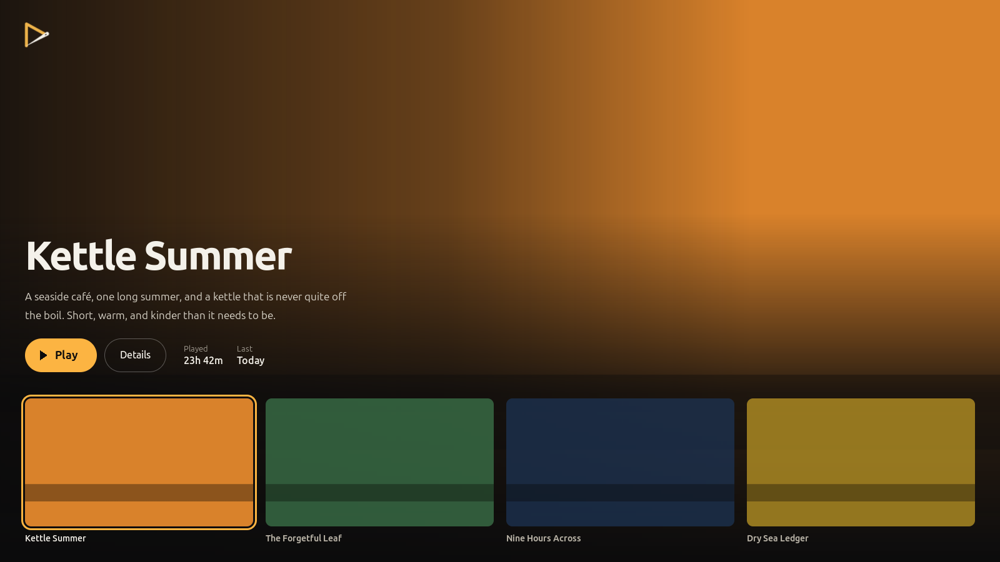

# Handcrafted

A game launcher for a library you keep by hand.

No VNDB, no Steam, no metadata pulled from anywhere. Every game is entered
by hand: a name, a line or two of description, the path to its launcher, and
a list of image links. That is where the name comes from.



## Status

In development, and usable: add, edit and delete games, give them images
from a list of links, see them grouped by status, play and stop them with
the time measured. Once something has been played, the window opens on a
hero with the game played last and the four most recent as tiles. Scroll
down to get from the hero to the library, and up again, from the top of the
list, to get back (or Alt+Down and Alt+Up). In English and German.

To look at it without a library of your own, fill a throwaway one:

```
HOME=/tmp/hc-demo /usr/bin/python3 tests/seed.py
HOME=/tmp/hc-demo /usr/bin/python3 -m handcrafted
```

## Requirements

Linux, Python 3, GTK 4 and libadwaita, via the system interpreter:

```
sudo apt install gir1.2-gtk-4.0 gir1.2-adw-1
```

Use `/usr/bin/python3`, not `python3`. On a machine with conda or miniforge
in the PATH, the latter has no `gi`.

## Install

```
/usr/bin/python3 install.py
```

This copies the program to `~/.local/share/handcrafted/app/`, builds the
translations, and puts Handcrafted and its icon into the desktop's menu.
It asks nothing, needs no root and touches nothing outside your home. Run
it again after pulling to update.

```
/usr/bin/python3 install.py --in-place    # the menu runs this repository
/usr/bin/python3 install.py --uninstall   # remove it again
```

`--uninstall` removes the program, the menu entry and the icon. Your
library, its images and your settings stay where they are.

## Run

From the menu once installed, or from the repository:

```
/usr/bin/python3 -m handcrafted
```

Starting it a second time brings the open window to the front.

The library lives in `~/.local/share/handcrafted/`; the window size, the
selected game and the hero in `~/.config/handcrafted/state.json`. A few
things can be set in `~/.config/handcrafted/config.json`:

```json
{
  "width": 1600,
  "height": 900,
  "data_dir": "~/.local/share/handcrafted",
  "language": "en"
}
```

`language` picks the interface language (`en` or `de`); without it, the
system's is used. Run from the repository, translations need building once
with `install.py --in-place`. `width` and `height` are the size of the very first window. After
that, the size it was last left at wins. A missing, broken or half-wrong
file is not an error: whatever cannot be used is ignored.

If moving between hero and library stutters, start it with
`HANDCRAFTED_DEBUG_FRAMES=1` in front: each change of page then prints how
long its frames took, which tells a slow program from a busy machine.

## Tests

No test runner to install. Run each file directly:

```
/usr/bin/python3 tests/test_config.py       # the settings file
/usr/bin/python3 tests/test_state.py        # what the window remembers
/usr/bin/python3 tests/test_library.py      # games and play sessions
/usr/bin/python3 tests/test_images.py       # images on disk
/usr/bin/python3 tests/test_formatting.py   # playtime and dates as text
/usr/bin/python3 tests/test_launch.py       # starting and timing games
/usr/bin/python3 tests/test_download.py     # images from links, locally
/usr/bin/python3 tests/test_paging.py       # when scrolling changes the page
/usr/bin/python3 tests/test_thumbs.py       # images read and kept
/usr/bin/python3 tests/test_translations.py # po/ complete and valid
/usr/bin/python3 tests/test_install.py      # install.py, in a throwaway home
DISPLAY=:0 /usr/bin/python3 tests/test_window.py   # the library view
DISPLAY=:0 /usr/bin/python3 tests/test_dialog.py   # adding and editing
DISPLAY=:0 /usr/bin/python3 tests/test_hero.py     # the hero and its tiles
```

## Translations

Texts are marked with `_()` in the code; English is the source. After
changing them, refresh the template and the German catalogue:

```
xgettext --language=Python --keyword=_ --keyword=ngettext:1,2 \
    --from-code=UTF-8 -o po/handcrafted.pot handcrafted/*.py
msgmerge --update --backup=none po/de.po po/handcrafted.pot
```

`tests/test_translations.py` fails while anything is left untranslated. A
new language is one more `po/<code>.po`.

## What it will not do

No online sources of any kind. No Wine or Proton. No importing of Steam,
Lutris or Heroic libraries. No settings window: what can be configured lives
in a file. No sync, no cloud, no second user.

## Licence

MIT. See [LICENSE](LICENSE).
